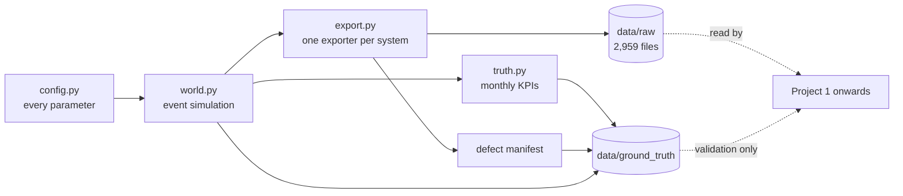

# Project 0: the Halden Roasters data generator

**All data in this repository is synthetic.** Halden Roasters is a fictional company, and
every customer, order and payment was produced by the code in `src/halden/generator/`.
The EUR to GBP exchange rates are synthetic too. Nothing here is real company data.

## Why this project exists

The other five projects in this portfolio are the work a small data team would do at one
company over about a year: fixing file loads, deduplicating customers, automating the KPI
pack, predicting churn and testing a retention offer. Each one needs the output of the one
before it. No public dataset has all of that for the same customers, so I built the company.

A generator only helps if it is honest about two things. The raw files have to break the
way real vendor files break. And the truth has to be stored separately, so every later
project can be scored against what really happened instead of against what looks right.

## What it produces

One command builds 30 months of history, from 1 January 2023 to 30 June 2025:

| | Count |
| --- | ---: |
| People | 20,142 |
| Customer accounts | 18,620 |
| People with more than one account | 952 |
| Subscriptions | 18,868 |
| Orders | 254,388 |
| Payment transactions | 269,586 |
| Shipments | 252,378 |
| Experiment assignments | 5,670 |
| Raw files | 2,959 (133.7 MB) |
| Defect records in the manifest | 17,025, of 28 types |

Of the 20,142 people, 17,617 have an account. The rest only ever checked out as guests,
plus one QA tester.



The raw files come from six source systems, each with its own format:

| Source | Files | Format |
| --- | ---: | --- |
| `shop` (orders and subscription events) | 1,826 | Daily CSV, UTF-8, London local time |
| `payproc` (card processor) | 911 | Daily pipe-delimited TXT with header and trailer, UTC |
| `ful` (fulfilment partner) | 132 | Weekly CSV, Windows-1252, semicolons, decimal commas |
| `crm` (customer database) | 29 | Monthly tab-delimited TXT, UTF-16 |
| `exp` (experiment platform) | 30 | Daily JSON Lines |
| `fx` (exchange rates, synthetic) | 31 | Monthly CSV |

Formats are specified in [`docs/source_specs.md`](../docs/source_specs.md), and the
company's story in [`docs/company.md`](../docs/company.md).

## How the simulation works

Every person is simulated through time. A subscriber gets a renewal order on each cycle. The
payment can fail, and is retried twice before the subscription lapses. A paid order is shipped,
and the parcel can be late or lost. After each box, the customer decides whether to cancel. That
chance depends on tenure, whether they joined on a 50% welcome offer, whether this parcel was
late, the February 2025 price increase, and the country. Some cancelled customers come back
later, and more than half of those open a new account with a different email. That is one of
the ways the same person ends up with two customer IDs.

The parameters are all in [`config.py`](../src/halden/generator/config.py), and they are
copied into `data/ground_truth/gt_parameters.json` on every build.

## The defects

Each defect belongs to the system that would really cause it. The table below is generated
from the manifest of this build.

| Code | Source | What it looks like | Records | Files |
| --- | --- | --- | ---: | ---: |
| `SHOP_TRUNCATED_FILE` | shop | Export stopped mid-file; last line cut off part-way | 14 | 1 |
| `SHOP_RESEND` | shop | Same business day sent again as `_resend.csv`, CRLF line endings | 272 | 1 |
| `SHOP_DATE_FORMAT` | shop | `created_at` as `DD/MM/YYYY HH:MM` (Excel re-save, Oct 2023; platform update, Feb 2024) | 3,784 | 14 |
| `SHOP_PHONE_SCIENTIFIC` | shop | File opened and re-saved in Excel: phone shows as `4.47712E+11` | 1,786 | 7 |
| `SHOP_MISSING_POSTCODE` | shop | `billing_postcode` blank | 3,833 | 892 |
| `SHOP_TEST_ORDER` | shop | QA order with a `@haldenroasters.test` address | 37 | 37 |
| `SHOP_AMBIGUOUS_LOCAL_TIME` | shop | London time inside the repeated hour when clocks go back | 215 | 2 |
| `SHOP_EMAIL_FORMATTING` | shop | Email with capitals or surrounding spaces | 1,255 | 668 |
| `SHOP_TRAILING_DELIMITER` | shop | Every line ends with an extra comma (export plugin bug) | 30 | 30 |
| `SHOP_BLANK_LINES` | shop | Blank lines at the end of the file | 16 | 16 |
| `SUBS_LATE_EVENT` | shop | Cancellation appears in the next day's subscription file | 104 | 97 |
| `SUBS_REASON_QUOTED` | shop | Free-text `cancel_reason` containing commas and quotes | 536 | 405 |
| `PAYPROC_DUPLICATE_ROW` | payproc | Same transaction row twice in one file; trailer counts it once | 15 | 3 |
| `PAYPROC_MISSING_DAY` | payproc | No file for a day; its rows arrive inside the next day's file | 1 | 1 |
| `PAYPROC_LATE_FILE` | payproc | File received more than 24 hours after the 06:00 UTC deadline | 4 | 4 |
| `PAYPROC_SCHEMA_CHANGE` | payproc | From 2024-07-01, schema v2: columns reordered, `net_amount` added | 1 | 1 |
| `PAYPROC_UNLINKED_REFUND` | payproc | Refund against an order from the pre-2023 shop | 12 | 12 |
| `FUL_ENCODING_CP1252` | ful | Windows-1252 file; reading as UTF-8 corrupts umlauts | 132 | 132 |
| `FUL_UNMAPPABLE_CHAR` | ful | Character outside Windows-1252 replaced by `?` by the partner | 1,629 | 132 |
| `FUL_CORRECTED_FILE` | ful | Week re-sent as `_v2.csv`; v1 had wrong delivery dates and weights | 902 | 1 |
| `FUL_DUPLICATE_EVENT` | ful | Delivery event repeated in the following week's file | 780 | 130 |
| `FUL_LATE_FILE` | ful | Weekly file received days late over Christmas | 2 | 2 |
| `CRM_DUPLICATE_PERSON` | crm | One person, more than one `customer_id` | 1,243 | 29 |
| `CRM_EMBEDDED_NEWLINE` | crm | Quoted notes field containing a line break or tab | 199 | 29 |
| `CRM_STRAY_QUOTE` | crm | Notes field opens a quote that never closes | 6 | 4 |
| `EXP_LOG_OUTAGE` | exp | Assignment events lost for part of the treatment group, 9 to 11 April 2025 | 126 | 3 |
| `EXP_DUPLICATE_EVENT` | exp | Same assignment event logged twice | 29 | 17 |
| `EXP_PERSON_BOTH_ARMS` | exp | One person with two accounts sits in both arms | 62 | 24 |

A record means one row, or `*` for a whole file. `CRM_DUPLICATE_PERSON` counts every
appearance of a duplicate account in an export, so it is higher than the 1,003 duplicate
accounts.

## What the truth says

`data/ground_truth/gt_monthly_metrics.csv` holds the KPIs a perfect pipeline would report,
computed with the definitions in [`docs/metrics.md`](../docs/metrics.md). A few months from
this build:

| Month | Active subscribers | Active accounts | Monthly churn | MRR (£) | Net revenue (£) | Late deliveries |
| --- | ---: | ---: | ---: | ---: | ---: | ---: |
| 2023-01 | 4,505 | 4,517 | 2.79% | 103,580.20 | 117,348.49 | 3.87% |
| 2024-10 | 6,261 | 6,325 | 5.82% | 143,777.65 | 161,277.14 | 5.19% |
| 2024-11 | 6,506 | 6,574 | 5.62% | 150,975.04 | 167,105.25 | 13.04% |
| 2025-02 | 6,960 | 7,036 | 7.36% | 175,103.06 | 188,580.00 | 4.64% |
| 2025-03 | 6,732 | 6,805 | 10.86% | 170,767.95 | 199,122.68 | 4.84% |
| 2025-06 | 6,647 | 6,714 | 5.83% | 170,036.55 | 175,478.81 | 5.13% |

Two business events are easy to see. The Hamburg staffing problem in November 2024 lifts the
late-delivery rate from about 5% to 13%. The February 2025 price increase lifts MRR straight away, and
churn peaks in March, after most subscribers have paid their first higher bill.

## Running it

```bash
make setup         # install pinned dependencies
make data          # build data/raw and data/ground_truth (about 110 seconds)
make test          # unit tests, and checks on the build in data/
make verify-data   # rebuild and compare every file with the published checksums
```

The build writes into a temporary folder and only replaces `data/raw` and
`data/ground_truth` once everything has been written. The [runbook](runbook.md) covers
reruns and failures.

## How I checked it

- **Reproducible.** I built twice with different `PYTHONHASHSEED` values. All 2,959 raw files
  and the ground truth were byte-identical. Their SHA-256 values are committed in
  `expected_checksums_raw.sha256` and `expected_checksums_ground_truth.sha256`.
- **Complete.** Every true order appears in exactly one shop file, apart from the 14 rows lost
  in the truncated export and one order created at 23:19 UTC on 30 June, which is 1 July in
  London and outside the window. Every true payment transaction appears in the processor files.
- **Defects are real.** A test fails if any defect in the catalogue is missing from the files.
  That test caught one of my own mistakes, described in the [build notes](build_notes.md).
- **Trailers add up.** Every processor file's trailer matches its unique rows, apart from the
  injected duplicates.
- **KPIs balance.** For every month, last month's subscribers plus new minus churned equals
  this month's.
- **Docs match the build.** A test reads the numbers in this README and compares them with
  `gt_build_summary.json`.

## Limitations

The data is cleaner than real data in ways I chose not to model. There are no refunds for
partial shipments, no plan changes and no paused subscriptions. Settlement ignores bank
holidays. Postcodes have the right shape but are not real, and do not match the city. The decision
log lists these and explains why.

## Files in this folder

- [`decision_log.md`](decision_log.md): what I chose, what I rejected and why
- [`runbook.md`](runbook.md): how to run, rerun and recover
- [`build_notes.md`](build_notes.md): what went wrong while building it
- [`manager_summary.md`](manager_summary.md): one page for a non-technical reader
