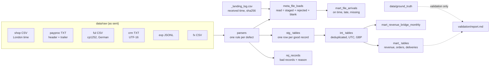

# Project 1: multi-source ingestion and revenue reconciliation

All data here is synthetic. It comes from the generator in [project 0](../project_00_data_generator/README.md),
and the exchange rates are synthetic too.

## The problem

In Q3 2024 finance noticed that the revenue in the monthly BI report did not match the money
the card processor said it had collected. Nobody could say by how much, or why. The BI report
was built by summing the shop's order files. Nobody had loaded the processor, fulfilment or
CRM files into one place.

I was asked two things. First, load all six source feeds into one warehouse that can be
rerun safely, keeps every bad record with a reason, and notices when a file is late or
missing. Second, explain the revenue gap one cause at a time, in pounds.

## The answer

Over the 30 months from January 2023 to June 2025, the old BI method reported
**4,761,866.00 GBP**. Net revenue, as defined in [`docs/metrics.md`](../docs/metrics.md), was
**4,554,211.37 GBP**. BI overstated revenue by 207,654.63 GBP, or 4.56% of net revenue. It was too high in every
one of the 30 months, by between 3.74% and 6.86%.

| Step | What changes | 30 months, GBP |
| --- | --- | ---: |
| 0 | Old BI report: every shop file row, file month, monthly average FX | 4,761,866.00 |
| 1 | Count each order once (258 orders of 18 March 2024 were loaded twice) | -4,552.21 |
| 2 | Remove QA test orders | -1,467.05 |
| 3 | Remove orders whose payment never succeeded | -40,320.09 |
| 4 | Book revenue in the UTC month the payment was captured | +8.06 |
| 5 | Convert EUR at the rate for the capture date, not the month average | +0.49 |
| 6 | Subtract refunds and chargebacks, including 12 with no order | -43,591.13 |
| 7 | Remove VAT | -117,732.75 |
| | Net revenue | 4,554,211.37 |

Each step is the difference between two measures, so the steps add up by construction. The
residual after rounding each month to the penny is -0.05 GBP in total and never more than 0.02
GBP in a month. The monthly table is `mart_revenue_bridge_monthly`.

Three causes explain almost all of the gap: VAT that BI never removed (57% of the gap),
refunds and chargebacks that BI never saw (21%), and failed payments that BI counted as sales
(19%). The duplicate March 2024 file is the cause most people look for first. It is 2% of the gap.

Step 4 looks harmless over 30 months, and it is not. It moves revenue between months by up to
1,706.20 GBP (March 2025). 938 renewals created just after midnight London time on the 1st of
a summer month were captured before midnight UTC, so they belong to the previous month. 680
orders were paid after their month ended because the first payment attempts failed. The two
effects nearly cancel over 30 months, but not within one.

## What was built

The warehouse is a single DuckDB file, `data/warehouse.duckdb`. The code is in
[`src/halden/ingest/`](../src/halden/ingest/).

| File | What it does |
| --- | --- |
| `profile.py` | Reads every raw file without changing it and writes [`profiling_report.md`](profiling_report.md) |
| `parsers.py` | One parser per feed. Every rule that fixes or rejects a record is here, with the reason |
| `landing.py` | Reads the landing log and compares arrivals with the feed calendar |
| `pipeline.py` | Loads new or changed files in one transaction per feed, then rebuilds the models |
| `schema.sql` | Explicit types for every staging, reject and ledger table |
| `models.sql` | The `int_` and `mart_` tables |
| `reconcile.py` | The revenue bridge |
| `validate.py` | Compares the warehouse with the ground truth and the defect manifest |
| `replay.py` | Replays history in three steps and checks the result equals one full load |

## What the files got wrong, and what the pipeline does about it

The profiling step came first. These are the problems it found, and how each one is handled.
The full list of 28 defect types is in project 0. Three of them (duplicate people in the CRM,
people in both experiment arms, and the experiment logging outage) are left for projects 2 and
5, because they need a decision about meaning, not a parsing rule.

| Source | Problem | Rule |
| --- | --- | --- |
| shop | Times are London wall-clock time with no offset | Convert to UTC. In the repeated autumn hour, use the first payment attempt to choose the instant |
| shop | 3,784 orders have UK-format minute-precision times (`03/10/2023 00:31`) | Parse both formats; record `created_at_precision = minute` |
| shop | The 18 March 2024 file was cut off after 258 orders, mid-line. The shop resent the whole day (272 orders) under a new name, and BI loaded both | Reject the broken line as `field_count_mismatch`. Keep both files in staging; in `int_orders` the file received last wins |
| shop | 30 files have a trailing comma on every line | Detect from the header and drop the empty last field |
| shop | Emails with spaces and capitals; phones turned into `4.47712E+11` by Excel | Keep the raw value; add `email_norm` and `is_phone_scientific` |
| shop | 37 QA test orders | Flag `is_test`; excluded from every metric |
| payproc | Schema v2 from 1 July 2024 reorders columns and adds `net_amount` | Read the version from the header record |
| payproc | 15 lines repeated inside a file | Reject the copy as `duplicate_record_in_file` |
| payproc | Every file has a trailer with a count and a gross total | Refuse a file with no trailer; check count and total for every file |
| payproc | No file for 12 September 2024; its rows came in the next day's file | Report the day as missing; load the rows from the file they are in |
| ful | Windows-1252, semicolons, decimal commas, German headers and dates | Decode, rename and convert; `has_replacement_char` for names cp1252 cannot hold |
| ful | A corrected `_v2` file for the week of 20 May 2024 | The highest version replaces the whole week |
| ful | 780 status events sent twice | Deduplicate on shipment number and status |
| crm | UTF-16 with a BOM, CRLF between records, LF inside notes | Split records on CRLF only, so notes keep their line breaks |
| crm | 6 records with an unclosed quote | Reject each as `unbalanced_quote`, so one bad quote cannot swallow the next record |
| exp | 29 events logged twice | Reject the copy as `duplicate_record_in_file` |

Rejected records go to `rej_records` with the file, the line number and the raw text. There
are 51 in total: 29 experiment duplicates, 15 processor duplicates, 6 CRM stray quotes and 1
truncated shop line.

## How I know it is right

`make validate` compares the warehouse with `data/ground_truth`, which no pipeline code
reads. All 13 checks pass. The full output is [`validation/report.md`](validation/report.md).

| Check | Result |
| --- | --- |
| Rows balance per file | 2,959 files; 1,092,692 records read = 1,092,609 staged + 51 rejected + 32 blank lines |
| Processor trailers | 911 of 911 files match their trailer count and gross total |
| Orders | 254,387 in the warehouse and in the truth, 0 missing, 0 extra |
| Order times | 250,603 of 250,603 exact times match to the second; 3,784 minute-precision times are within 59 seconds |
| Autumn repeated hour | 215 of 215 orders resolved to the true instant |
| Transactions | 269,452 matched on ID and amount |
| Shipments | 252,221 shipments; 249,663 delivered, all with the true date and lateness |
| Net revenue | Matches the truth to the penny in all 30 months |
| Paid orders | 29 months match; June 2025 is 26 short, all of them paid after 30 June or in the 1 July file |
| Late delivery rate | Matches the truth in every month |
| Revenue bridge | Largest monthly residual 0.02 GBP |
| Defects | 25 types in scope, 14,994 of 14,994 defect records found, 0 missed, 0 extra |

The June 2025 gap is real and expected. The truth knows about payments that succeeded in
July. The warehouse stops at the 30 June files, as it would have on the day.

The report also traces ten random orders (seed 7) from their raw file and line to the
warehouse and the truth.

### Safe to rerun

A second run with no new files loads nothing and finishes in about 4 seconds. A test changes
one shop file, reruns, and checks that its old rows were replaced rather than added to.

### Late and missing files, replayed

`make replay` rebuilds the warehouse in three runs, as if it had been running at the time.
From [`validation/replay.md`](validation/replay.md):

| Run | Sees files received up to | Files visible | Files loaded | Processor 12 Sep 2024 | Processor 21 Oct 2024 |
| --- | --- | ---: | ---: | --- | --- |
| 1 | 2024-09-14 06:00 UTC | 1,996 | 1,996 | missing | not yet due |
| 2 | 2024-10-23 06:00 UTC | 2,120 | 124 | missing | missing |
| 3 | everything | 2,959 | 839 | missing | late (35.2 h) |

The 21 October file was missing on the morning of 23 October and turned up 35.2 hours after
its deadline. The 12 September file never arrived, because its rows were in the 13 September
file. After the third run, seven tables, from `int_orders` to the revenue bridge, are
identical row for row to a single full load.

Over the full window, 5 of 912 processor days and 2 of 131 fulfilment weeks were late or
missing. Every shop, CRM and FX file was on time.

### Tests

`make test` runs 22 tests for this project: 13 parser and calendar tests on small hand-written
files, 2 load tests on a slice of the real build, and 7 that check every figure in this
README and the manager summary against the last validation run. CI on GitHub also runs
`make ingest`, `make validate` and `make replay`, and fails if the committed validation and replay
reports differ from the ones it produces.

## Limits

- The data is synthetic, and I wrote the generator. The defects are realistic, but the
  pipeline was written knowing which defects exist. The validation shows the rules are
  implemented correctly. It cannot show I would have found every problem in unknown data.
  The profiling report is what I would have had to go on, and every rule traces back to it.
- All 215 orders in the repeated autumn hour resolved to the first of the two instants,
  because renewals run in the nightly batch. The rule for the second instant is written and
  tested on a small file, but this data never uses it.
- The CRM still has duplicate people. That is project 2.
- VAT rates are fixed for the whole window. See [`docs/metrics.md`](../docs/metrics.md).

## Read next

- [`decision_log.md`](decision_log.md): what I chose, what I rejected and why
- [`runbook.md`](runbook.md): how to run it, and what to do when it fails
- [`build_notes.md`](build_notes.md): what went wrong while building it
- [`manager_summary.md`](manager_summary.md): one page for people who will not read the code
