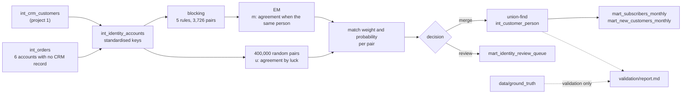

# Project 2: customer identity resolution

All data here is synthetic. It comes from the generator in [project 0](../project_00_data_generator/README.md)
and the warehouse built in [project 1](../project_01_ingestion/README.md).

## The problem

In Q4 2024 marketing questioned the customer count. The CRM listed one row per account, and
everyone reported accounts as customers. But people end up with more than one account: the
March 2023 CRM migration imported part of the legacy list twice, some customers opened a
second account with a work email, and people who cancelled often came back on a new account
instead of logging in to the old one.

Nobody knew how many real people there were, so nobody knew whether the subscriber count,
the churn rate or the number of new customers each month could be trusted.

I was asked to find which accounts belong to the same person, say how sure I am, and restate
the customer numbers on a per-person basis.

## The answer

The 18,620 accounts belong to 17,616 people. The CRM overstated the customer base by 1,004
accounts, or 5.70%.

How much that matters depends on the number:

| Measure | Counting accounts | Counting people | Overstated by |
| --- | ---: | ---: | ---: |
| Customers with an account | 18,620 | 17,616 | 5.70% |
| New customers, January 2023 to June 2025 | 14,420 | 13,416 | 7.48% |
| Active subscribers, June 2025 | 6,714 | 6,647 | 1.01% |
| Average monthly churn rate | 6.480% | 6.426% | 0.05 points |

The biggest error is in new customers. 1,004 of the 14,420 accounts opened in the window
belonged to someone who already had one, so the real cost per new customer was 7.5% higher
than marketing reported. The active subscriber count was only off by 0.27% to 1.18% in any month, because most
duplicate accounts are old accounts their owner stopped using. Churn barely moves: a
customer who cancels and comes back a few months later on a new account is lost and won
again under either count.

Checked against the ground truth, the method found all 1,057 true pairs of accounts and made
one false merge. On the half of the data I never looked at while building it, precision is
0.9981 and recall is 1.0000.

## How it works

**1. Standardise.** Each account gets match keys. The raw values are kept. Names are lower-cased with umlauts written
out (`Jürgen Groß` becomes `juergen gross`) and common short names mapped to the formal one
(`Will` to `william`). Phone numbers become international digits, so `+44(0)161 496 0054`
and `0161 496 0054` agree. Emails ignore case, spaces, and gmail's dots and `+tags`, because
gmail delivers all of those to one inbox. Postcodes lose their spaces.

**2. Block.** Comparing every account with every other would be 173 million pairs. A pair is
compared only if it shares a phone number, a mailbox, a legacy ID, a postcode and surname
initial, or a full name and town. That gives 3,726 pairs, and every true pair is among them.

**3. Score.** For each pair, each of eight fields lands on an agreement level, for example
surname exact, close, loosely close, or different. Each level has two probabilities: `m`, how
often a true duplicate lands there, and `u`, how often two different people do. The evidence
from a field is `log2(m / u)`. The pair's match weight is the sum of the evidence, plus the
prior odds. This is the Fellegi-Sunter model, the standard method for record linkage.

`u` comes from 400,000 random pairs of accounts, which are almost all different people. `m`
comes from expectation maximisation (EM) on the candidate pairs, with no labels. Common
values count for less: two Smiths in London prove less than two Wiśniewskis.

**4. Decide.**

| Decision | Rule | Pairs |
| --- | --- | ---: |
| merge | Match probability at least 0.99, and the pair shares a phone number, a mailbox, a legacy ID, or the same first name at the same street and postcode | 1,058 |
| review | Match probability at least 0.5, but not merged | 2 |
| no | Everything else | 2,666 |

A name and a town are never enough to merge on their own. A person in the review queue
decides those, by adding a row to [`review_decisions.csv`](review_decisions.csv). Those
decisions override the model on every later run: "same" merges the pair, "different" keeps
it apart for good, even through a chain of other merges.

**5. Build people.** Merged pairs are joined with union-find: if A is B and B is C, all three
are one person, named after their oldest account. A person may not hold two different legacy
IDs, because the old system already had one account per customer. No merge was blocked by
that rule in this run, but it stops a chain of weak links from joining two real customers.

The whole run takes about 2 seconds.

## What the data looked like

From [`profiling_report.md`](profiling_report.md), before any matching:

- Phone numbers come in 75 different digit patterns.
- 2,454 phone numbers are shared by more than one account, covering 5,443 accounts. Most of
  those are different people: of the 3,636 pairs that share a phone, 2,578 were not merged.
  Shared landlines and recycled numbers are common, so a phone number alone is not proof.
- Matching emails as typed finds 96 shared mailboxes. After ignoring case and gmail dots,
  there are 160.
- 175 first names are only an initial, and 198 names are in capitals.
- 6 accounts have no CRM record at all, because project 1 quarantined their CRM rows for a
  stray quote. They are built from their latest shop order instead, so they are not lost.

## How I know it is right

`make identity-validate` compares the result with `data/ground_truth`, which no other project
2 code reads. People are split by their true person number: even numbers are the development
half and odd numbers the holdout half. While building the rules I looked only at errors in
the development half. All 5 checks pass; the full output is
[`validation/report.md`](validation/report.md).

| Half | True pairs | Predicted pairs | False merges | Missed | Precision | Recall |
| --- | ---: | ---: | ---: | ---: | ---: | ---: |
| Development | 527 | 527 | 0 | 0 | 1.0000 | 1.0000 |
| Holdout | 530 | 531 | 1 | 0 | 0.9981 | 1.0000 |

Pairs are counted inside the final people, so if A-B and B-C are merged, A-C counts too.

The one false merge is Rachel Young and Rachael Young, both in London, with the same phone
number but different emails and addresses. They are two different people. With the same surname, the same phone and nearly the
same first name, a human reviewer could easily make the same call. Both pairs in the review queue are different people too: Jonathan and Laura Holmes,
and Danny and Sean Ahmed, each pair sharing a phone and a surname. They look like
households, which is what the review queue is for.

Every duplicate was found, whatever its cause: 168 from the migration, 260 parallel accounts
and 575 customers who came back on a new account.

The restated subscriber counts match the truth within 1 in every month, and new customers
within 1 in every month. The account-level counts match exactly.

### When customers give less information

The generator copies a person's phone number onto every account they open. Real customers
change numbers, and a method that only works because of that would be useless. So the
validation reruns the whole method, weights included, after damaging the data:

| Field | Change | Share of accounts | Precision | Recall | Review pairs | Of which same person |
| --- | --- | ---: | ---: | ---: | ---: | ---: |
| phone | removed | 30% | 0.9978 | 0.8717 | 94 | 53 |
| phone | changed to a new number | 30% | 0.9978 | 0.8717 | 121 | 53 |
| email | removed | 30% | 0.9981 | 1.0000 | 2 | 0 |
| postcode | removed | 50% | 0.9944 | 1.0000 | 4 | 0 |

The phone is the field the method depends on most. Without it for 30% of accounts, recall
falls to 0.87, and 53 of the pairs it could not merge are waiting in the review queue. That
is a few hours of work for one person, not a failure. Precision barely moves in any test.

The "same home" part of the merge rule was added because of this test. Without it, the
phone test left recall at 0.54 on the development half, and 359 pairs in the review queue.

### Tests

`make test` runs 22 tests for this project:

- 6 on the standardised keys
- 8 on the model, the merge rules and the review decisions. One checks that EM recovers
  known `m` values from simulated data.
- 1 on the real build, checking that every account gets one person and that two runs are
  identical
- 7 that check the numbers in this README and the manager summary against the last
  validation run

CI runs the identity step and its validation, and fails if the committed report changes.

## A change to project 0

While profiling I found accounts of different people sharing one mailbox: 55 pairs in the
development half alone. The generator had built emails from names without checking whether the
address was already taken, so two unrelated people could share `jbailey@outlook.com`. That
is a flaw in the simulation, not a realistic defect. I fixed the generator so each address
belongs to one person. The fix makes no random draws, so every count in the build and
every project 1 report stayed exactly the same. It is recorded in
[`docs/change_log.md`](../docs/change_log.md) and in the project 0 decision log.

## Limits

- I wrote the generator, so I know how duplicates were made. The holdout split stops me
  tuning to the answers, but it cannot make me forget the generator's rules. The stress
  tests are the closest thing to unknown data.
- The nickname list is mine. It covers the nicknames the generator uses, so recall on
  nicknames is optimistic.
- Guest orders (no account) are not linked to people. 2,525 people in the truth only ever
  checked out as guests. Linking them by email is a small next step, but no current metric
  needs it.
- The merge threshold of 0.99 is a judgement, not an optimum. Every merged pair scored above
  0.9999 and every other pair below 0.88. In the development half, any threshold from 0.9 to
  0.9999 gives the same people; at 0.5, one of the review pairs would be merged by mistake.
  This data cannot separate 0.9 from 0.99, so I kept the stricter one.

## Read next

- [`decision_log.md`](decision_log.md): what I chose, what I rejected and why
- [`runbook.md`](runbook.md): how to run it, and how to work the review queue
- [`build_notes.md`](build_notes.md): what went wrong while building it
- [`manager_summary.md`](manager_summary.md): one page for people who will not read the code
