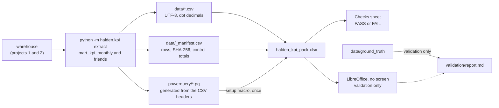

# Project 3: monthly KPI pack in Excel and Power Query

All data here is synthetic. It comes from the warehouse built in
[project 1](../project_01_ingestion/README.md) and the per-person counts from
[project 2](../project_02_identity/README.md).

## The problem

By Q4 2024 Halden Roasters had a clean warehouse and a per-person customer count, but the
monthly KPI pack that goes to the founders was still put together by hand. Someone exported
numbers from three places, pasted them into last month's spreadsheet and fixed the formulas
that broke. Nobody could say which definition of "active subscriber" a given month used, and
a pasted range that was one row short would go out unnoticed.

I was asked for a pack that updates itself, uses the definitions in
[`docs/metrics.md`](../docs/metrics.md), and refuses to look finished when the data behind it
is wrong. It had to stay in Excel, because that is what the founders open.

## The answer

[`halden_kpi_pack.xlsx`](halden_kpi_pack.xlsx), built for Excel 365 on Windows. Pick a month
in one cell and the Summary sheet shows that month against the previous month and the same
month a year earlier, by country, and the revenue bridge from project 1. The monthly update is
Data > Refresh All. Nothing is typed in by hand.

June 2025, as the pack shows it:

| Metric | June 2025 | May 2025 | June 2024 |
| --- | ---: | ---: | ---: |
| Active subscribers (people) | 6,647 | 6,572 | 6,055 |
| Monthly churn rate | 5.81% | 7.95% | 6.14% |
| MRR, GBP | 170,098 | 169,495 | 140,221 |
| Net revenue, GBP | 175,479 | 173,429 | 156,619 |
| Late delivery rate | 5.13% | 5.23% | 4.64% |

The pack checks itself every time it calculates. A Checks sheet compares the loaded data with
a manifest written next to the CSV files (row counts and a control total per file), confirms
that the revenue bridge adds up and that the countries add up to the total, and the Summary
sheet shows either "All checks pass" or "CHECK FAILED". In validation, all 270 figures on the
Summary sheet matched the warehouse in the five months I tested, and every one of the three
broken copies I made was caught.

What I could not test here is the Power Query refresh itself, because Power Query only runs
inside Excel. The M scripts and the setup macro are written for Windows Excel 365 and have
not yet been run on it. The runbook has the steps and what to look for.

## How it works

**1. Every number comes from the warehouse.** `extract` builds four tables in DuckDB:

| Table | One row per | What it adds |
| --- | --- | --- |
| `ref_plan_prices` | plan, currency and price period | The list prices from [`docs/company.md`](../docs/company.md), including the February 2025 increase |
| `mart_mrr_monthly` | month and country | MRR as defined in `docs/metrics.md` |
| `mart_kpi_monthly` | month | Every metric in `docs/metrics.md`, in one row |
| `mart_kpi_country_monthly` | month and country | Subscribers, MRR and net revenue by country |

It then writes three CSV files and a manifest. Excel does no arithmetic on the metrics
themselves, only comparisons between months and the checks, so the workbook cannot disagree
with the warehouse about what a metric means.

**2. Power Query reads the files.** Each `.pq` script is generated from its CSV file's header,
so a new column can never be missing from its query. Each one reads the folder from a named
cell, reads UTF-8 explicitly, types every column with the `en-US` culture, and stops with an
error if the columns are not the expected ones. The culture matters: on a PC set to German or
Arabic regional settings, "0.05813" would otherwise be read as 5,813.

**3. The formulas find columns by name.** Every lookup is `INDEX` and `MATCH` on a Data_
sheet's whole columns, with the column found by its header. Nothing refers to a fixed column
letter or a table name, so the formulas survive a refresh that replaces a table, adds a month
or reorders columns. The previous month and the year-ago month are the selected month's row
minus 1 and minus 12, which works because the queries sort by month.

**4. The file ships with a snapshot.** The Data_ sheets hold the data as of the last build, so
the file opens and works anywhere, including in a browser preview. Running
[`vba/setup_power_query.bas`](vba/setup_power_query.bas) once replaces each snapshot with a
Power Query table. After that the macro can be removed and the file saved as `.xlsx`.

The sheets:

| Sheet | What it shows |
| --- | --- |
| Cover | What the pack is, that the data is synthetic, how to use it |
| Summary | 11 metrics for the chosen month, the month before and a year earlier; by country; the revenue bridge |
| Trend | 30-month charts of subscribers, net revenue, churn and late delivery |
| Checks | 11 checks and an overall PASS or FAIL |
| Definitions | Every metric's definition, copied from `docs/metrics.md` when the file was built |
| Settings | The data folder Power Query reads |
| Data_Monthly, Data_Country, Data_Bridge, Data_Manifest | The loaded data |

## How I know it is right

`make kpi-validate` does three things. The full output is in
[`validation/report.md`](validation/report.md).

**The workbook shows what the warehouse holds.** For five months I set the month cell,
recalculated the file in LibreOffice with no screen, and compared every figure on the Summary
sheet with the warehouse. I picked the months that break lookups: January 2023 has no
previous month and no year-ago month, February 2023 has a previous month only, and January
2024 is the first month with a year-ago month. 270 values compared, 0 mismatches.

**The checks catch a bad refresh.** I broke three copies on purpose:

| Broken copy | Overall check | Caught |
| --- | --- | --- |
| Data_Country loaded with its last row missing | FAIL | yes |
| June 2025 net revenue loaded as the text "175478,81", as a comma-decimal PC would without the culture setting | FAIL | yes |
| A month typed into the month cell that is not in the data | FAIL | yes |

**The warehouse agrees with the ground truth.** Gross revenue, net revenue, late delivery and
active subscription accounts match the generator's own figures exactly in all 30 months. The
other differences are all ones I can name:

- The person-level counts (active, new and churned subscribers, and churn rate) are off by 1
  in at most three months. That is project 2's one false merge: two people with nearly the
  same name and the same phone, counted as one.
- Paid orders in June 2025 is 26 lower than the truth, because those orders were paid after
  30 June or sit in the 1 July shop file. Project 1 explains this.
- MRR in June 2025 is 61.48 GBP higher than the truth. One subscription was cancelled at
  19:33 UTC on 30 June and another started at 23:19 UTC; both events are in the 1 July
  file. Priced the way the pack prices them, they account for the whole 61.48. I left the
  figure as the warehouse sees it. A pack that quietly differs from its own source is worse
  than one with a known lag, and loading the 1 July file will restate June.

### Tests

`make test` runs 20 tests for this project:

- 5 on the Power Query scripts: each one's column list and types match its CSV file, with
  Windows line ends, single backslashes, UTF-8 and the en-US culture
- 4 on the extract: negative zero, the manifest against the committed files, every month
  present once, and two runs giving the same files as the committed ones
- 4 on the workbook: the committed file is byte-identical to a fresh build, no formula uses a
  function older Excel or LibreOffice lacks, every column a formula names exists, and the
  month picker and data folder names are in place
- 7 that check the numbers in this README, the runbook and the manager summary against the
  committed files and the last validation run

CI installs LibreOffice, rebuilds the pack, reruns the validation, and fails if any committed
file in this folder changes, the workbook included.

## Limits

- Power Query and the setup macro have not been run in Windows Excel yet. Everything that
  can be checked without Excel has been. The first refresh on a real machine is the remaining
  test, and the runbook lists what to check.
- Excel may ask about privacy levels the first time a query combines the data folder cell
  with the CSV files. The runbook says what to choose.
- The Trend charts cover the 30 months this copy was built with. When the history grows, the
  file should be rebuilt with `make kpi` rather than the chart ranges edited by hand.
- The pack shows a month as the warehouse saw it on the last day. Late events, like the two
  subscriptions above, restate the latest month when the next day's files load.
- 13 transactions, mostly refunds, cannot be linked to an order and so have no country. On
  the country table the GBP ones go to the United Kingdom and the EUR ones to Germany, the
  largest euro market. That puts -64.48 GBP on Germany over 30 months that may belong to
  Ireland or the Netherlands. The monthly totals are not affected.
- Net revenue by country rounds each country separately, so the four countries can differ
  from the total by a few pence (0.04 GBP over 30 months in this build).

## Read next

- [`decision_log.md`](decision_log.md): what I chose, what I rejected and why
- [`runbook.md`](runbook.md): the monthly update, the one-time setup in Excel, and what to do when a check fails
- [`build_notes.md`](build_notes.md): what went wrong while building it
- [`manager_summary.md`](manager_summary.md): one page for people who will not read the code
